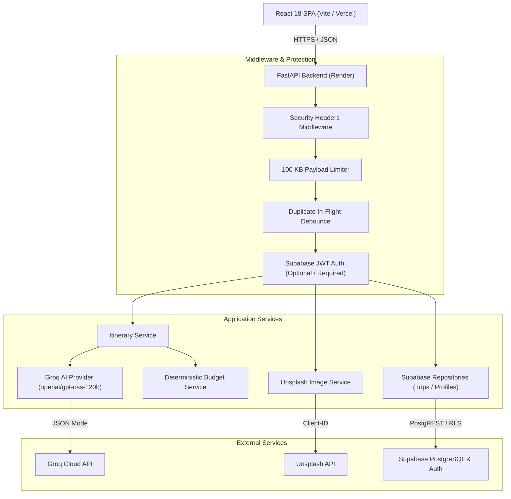

# TripGenie AI — Personalized AI Travel Planner

**TripGenie AI** is a modern, full-stack travel planning platform that generates personalized, day-wise itineraries tailored to destination, travel dates, budget, travellers count, travel style, and specific interests.

The system combines ultra-fast AI generation via **Groq Cloud API** (`openai/gpt-oss-120b`), curated landscape photography via **Unsplash API**, secure user management and persistence via **Supabase PostgreSQL & Auth**, and deterministic financial accounting calculated in backend application code.

---

## 1. Features

- **Personalized Day-Wise Timeline:** Structured daily itineraries divided into morning, afternoon, evening, and night activities with durations, categories, descriptions, locations, and suggested start times.
- **Deterministic Financial Accounting:** Activity totals, category breakdowns (transport, accommodation, food, activities, shopping, miscellaneous), and per-person estimates are calculated authoritatively by backend code rather than relying on LLM arithmetic.
- **Smart Budget Optimizer:** Proposes practical, lower-cost alternative activities, stays, and transit options when an itinerary exceeds the traveller's budget, recalculating revised totals on the server.
- **Destination Photography:** Landscape destination photography with photographer attribution fetched server-side via the Unsplash API with automatic curated fallbacks.
- **Supabase Authentication & RLS:** Secure user registration, profiles, travel preferences, and saved trips protected by PostgreSQL Row Level Security (RLS) policies.
- **Strict Input & Output Validation:** Pydantic v2 schemas sanitize incoming request payloads and validate AI JSON responses with bounded error retries.
- **Production Reliability:** Security headers, request tracing (`x-request-id`), 100 KB payload limits, in-flight duplicate request debouncing, and automated credential redaction in diagnostic logs.
- **Responsive UI:** Modern React interface styled with Tailwind CSS and Lucide icons, supporting mobile, tablet, and desktop viewports.

---

## 2. Technology Stack

| Layer | Technology | Purpose |
|---|---|---|
| **Frontend** | React 18, TypeScript, Vite | Fast, responsive single-page application (SPA) |
| **Styling** | Tailwind CSS, Lucide Icons | Modern utility-first styling and iconography |
| **Backend** | Python 3.11+, FastAPI, Uvicorn | High-performance asynchronous REST API |
| **Validation** | Pydantic v2, Pydantic Settings | Strict schema enforcement and environment management |
| **AI Generation** | Groq Cloud API (`openai/gpt-oss-120b`) | Ultra-fast structured JSON itinerary generation |
| **Images** | Unsplash API | High-resolution destination photography |
| **Database & Auth** | Supabase (PostgreSQL + GoTrue Auth) | Relational persistence, JWT verification, and RLS |
| **Testing** | pytest, pytest-anyio, httpx | Automated test suite (84 unit and endpoint tests) |
| **Deployment** | Vercel (Frontend) & Render (Backend) | Independent, scalable cloud hosting |

---

## 3. Project Architecture



---

## 4. Repository Folder Structure

```text
TripGenie_Project/
├── Backend/
│   ├── app/
│   │   ├── api/v1/endpoints/       # FastAPI route handlers (health, itineraries, images, trips, users)
│   │   ├── core/                   # Auth verification, exceptions, and safe logging
│   │   ├── db/                     # Supabase client and connection management
│   │   ├── middleware/             # Security headers, body size limit, duplicate guard
│   │   ├── repositories/           # Database repositories (profiles, trips, preferences)
│   │   ├── schemas/                # Pydantic v2 data models (itinerary, budget, image, user, trip)
│   │   ├── services/               # Business logic, budget engine, optimizer, and Unsplash
│   │   │   └── ai/                 # Groq itinerary provider and prompt engineering
│   │   ├── utils/                  # Input sanitization and text utilities
│   │   ├── config.py               # Application settings and environment parsing
│   │   └── main.py                 # FastAPI application factory and lifespan
│   ├── supabase/
│   │   └── migrations/             # SQL migrations (profiles, trips, user_preferences, RLS)
│   ├── tests/                      # Automated pytest suite (84 tests)
│   ├── .env.example                # Backend environment variable template
│   ├── pytest.ini                  # Pytest configuration
│   ├── requirements.txt            # Python dependencies
│   ├── run.py                      # Local development runner
│   ├── API_DOCUMENTATION.md        # Comprehensive REST API documentation
│   └── SUPABASE_SETUP.md           # Database setup and migration guide
├── Frontend/
│   ├── src/
│   │   ├── components/             # React UI components (TravelForm, ItineraryDisplay, BudgetSummary, etc.)
│   │   ├── services/               # API service, Supabase token injection, and image client
│   │   ├── types/                  # TypeScript interface definitions
│   │   ├── App.tsx                 # Root application component
│   │   └── main.tsx                # React entry point
│   ├── .env.example                # Frontend environment variable template
│   ├── package.json                # Frontend dependencies and scripts
│   ├── tailwind.config.js          # Tailwind CSS styling configuration
│   ├── tsconfig.json               # TypeScript configuration
│   ├── vercel.json                 # Vercel deployment routing configuration
│   └── vite.config.ts              # Vite bundler configuration
├── render.yaml                     # Render Blueprint deployment configuration
└── README.md                       # Main project documentation
```

---

## 5. Prerequisites

- **Python:** 3.11 or higher
- **Node.js:** 18.0 or higher (with npm)
- **Groq API Key:** From [Groq Console](https://console.groq.com/)
- **Supabase Project:** Free tier project from [Supabase](https://supabase.com/)
- **Unsplash Access Key (Optional):** From [Unsplash Developer Portal](https://unsplash.com/developers) *(curated fallback images are used if omitted)*

---

## 6. Backend Setup & Run Instructions

### 1. Set Up Python Virtual Environment
```bash
cd Backend
python -m venv venv

# Windows PowerShell:
.\venv\Scripts\Activate.ps1

# macOS/Linux:
source venv/bin/activate
```

### 2. Install Dependencies
```bash
pip install -r requirements.txt
```

### 3. Configure Environment Variables
Create `Backend/.env` based on `Backend/.env.example`:
```bash
cp .env.example .env
```
Fill in your `GROQ_API_KEY`, `SUPABASE_URL`, and `SUPABASE_ANON_KEY`.

### 4. Run the Backend Server
```bash
python run.py
```
Or directly with Uvicorn:
```bash
uvicorn app.main:app --host 0.0.0.0 --port 8000 --reload
```
The API is available at `http://localhost:8000`. Interactive documentation is accessible at `http://localhost:8000/docs`.

### 5. Run Backend Tests
```bash
python -m pytest -v
```

---

## 7. Frontend Setup & Run Instructions

### 1. Install Dependencies
```bash
cd Frontend
npm install
```

### 2. Configure Environment Variables
Create `Frontend/.env` based on `Frontend/.env.example`:
```bash
cp .env.example .env
```
Verify that `VITE_API_BASE_URL` points to `http://localhost:8000`.

### 3. Start the Development Server
```bash
npm run dev
```
The React application will be available at `http://localhost:5173`.

### 4. Build for Production
```bash
npm run build
```

---

## 8. Environment Variables Reference

### Backend (`Backend/.env`)
| Variable | Required | Description | Default / Example |
|---|:---:|---|---|
| `PORT` | No | Server listening port | `8000` |
| `NODE_ENV` | Yes | Environment mode | `development` or `production` |
| `CLIENT_ORIGIN` | Yes | Allowed frontend origin(s), comma-separated | `http://localhost:5173` |
| `GROQ_API_KEY` | Yes | Groq Cloud API access key | `gsk_...` |
| `GROQ_MODEL` | No | Groq LLM model name | `openai/gpt-oss-120b` |
| `GROQ_TIMEOUT` | No | AI inference timeout (seconds) | `30.0` |
| `UNSPLASH_ACCESS_KEY` | No | Unsplash API access key | `your_key` *(uses fallbacks if empty)* |
| `SUPABASE_URL` | Yes | Supabase Project URL | `https://xyz.supabase.co` |
| `SUPABASE_ANON_KEY` | Yes | Supabase public anonymous key | `eyJhbGciOi...` |
| `SUPABASE_SERVICE_ROLE_KEY` | No | Supabase service-role administrative key | `eyJhbGciOi...` |
| `SUPABASE_JWT_SECRET` | No | Secret for fast symmetric JWT verification | `your_jwt_secret` |
| `MAX_BODY_SIZE_BYTES` | No | Request body size limit in bytes | `102400` (100 KB) |
| `RATE_LIMIT_MAX_REQUESTS` | No | Maximum requests per 15-minute window | `20` |

### Frontend (`Frontend/.env`)
| Variable | Required | Description | Example |
|---|:---:|---|---|
| `VITE_API_BASE_URL` | Yes | Base URL of the FastAPI backend | `http://localhost:8000` (Local) / `https://tripgenie-backend.onrender.com` (Production) |

---

## 9. API Endpoint Overview

| Method | Endpoint | Auth | Purpose |
|---|---|:---:|---|
| `GET` | `/api/health` | Public | Server uptime and health probe |
| `GET` | `/api/health/database` | Public | Diagnostic database connection probe |
| `POST` | `/api/itineraries/generate` | Optional | Generate itinerary & compute deterministic budget |
| `POST` | `/api/itineraries/optimize-budget` | Optional | Propose cost-saving itinerary alternatives |
| `GET` | `/api/images/destination` | Optional | Retrieve Unsplash destination photography |
| `GET` | `/api/users/me` | Bearer | Retrieve authenticated user profile |
| `PUT` | `/api/users/me/profile` | Bearer | Update user profile |
| `GET` | `/api/users/me/preferences` | Bearer | Retrieve user travel preferences |
| `PUT` | `/api/users/me/preferences` | Bearer | Upsert user travel preferences |
| `GET` | `/api/trips` | Bearer | List user's saved trips (paginated) |
| `POST` | `/api/trips` | Bearer | Save a new trip itinerary |
| `GET` | `/api/trips/{trip_id}` | Bearer | Retrieve single saved trip by ID |
| `PUT` | `/api/trips/{trip_id}` | Bearer | Update an existing saved trip |
| `DELETE` | `/api/trips/{trip_id}` | Bearer | Delete a saved trip |

For detailed request payloads and response envelopes, see [`Backend/API_DOCUMENTATION.md`](Backend/API_DOCUMENTATION.md).

---

## 10. Supabase Database Configuration

The application uses PostgreSQL with Row Level Security (RLS) managed through three migration scripts in [`Backend/supabase/migrations/`](Backend/supabase/migrations/):

1. `001_create_profiles.sql`: Creates `profiles` table linked to Supabase Auth (`auth.users`) with auto-creation trigger.
2. `002_create_trips.sql`: Creates `trips` table for saving itineraries with ownership validation.
3. `003_create_user_preferences.sql`: Creates `user_preferences` table storing default travel styles.

To execute migrations, navigate to your Supabase project dashboard $\to$ **SQL Editor**, and execute the scripts in order. For detailed instructions, refer to [`Backend/SUPABASE_SETUP.md`](Backend/SUPABASE_SETUP.md).

---

## 11. Deployment Instructions

### Backend Deployment (Render)
1. Fork or push this repository to GitHub.
2. In the Render Dashboard, create a **New Blueprint Instance** and select your repository. Render automatically reads [`render.yaml`](render.yaml).
3. Alternatively, create a **Web Service**:
   - **Root Directory:** `Backend`
   - **Environment:** `Python 3`
   - **Build Command:** `pip install -r requirements.txt`
   - **Start Command:** `uvicorn app.main:app --host 0.0.0.0 --port $PORT`
   - **Health Check Path:** `/api/health`
4. Set the required environment variables (`GROQ_API_KEY`, `SUPABASE_URL`, `SUPABASE_ANON_KEY`, `CLIENT_ORIGIN`, `NODE_ENV=production`).

### Frontend Deployment (Vercel)
1. In the Vercel Dashboard, import the repository.
2. Configure project settings:
   - **Root Directory:** `Frontend`
   - **Framework Preset:** `Vite`
   - **Build Command:** `npm run build`
   - **Output Directory:** `dist`
3. Add the environment variable:
   - `VITE_API_BASE_URL`: `https://your-backend-service.onrender.com`
4. Deploy. Vercel automatically applies [`Frontend/vercel.json`](Frontend/vercel.json) rewrite rules for SPA client routing.

---

## 12. Basic Troubleshooting

- **CORS Error (`Origin Not Allowed`):**
  Ensure the frontend URL is included in `CLIENT_ORIGIN` in the backend environment variables.
- **HTTP 503 (`AI service unavailable`):**
  Ensure `GROQ_API_KEY` is set in `Backend/.env` and the server was restarted.
- **HTTP 413 (`Payload too large`):**
  The server enforces a strict 100 KB payload limit (`MAX_BODY_SIZE_BYTES`).
- **Database Connection Failure:**
  Verify `SUPABASE_URL` and `SUPABASE_ANON_KEY`. Check `/api/health/database` for diagnostic connection details.
